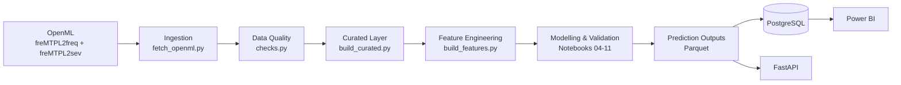

# Kfz Insurance Risk & Pure Premium Intelligence Platform

End-to-End-Analytics-Prototyp zur datenbasierten Risikobewertung in der Kfz-Versicherung.

Das Projekt verarbeitet historische Versicherungsdaten, modelliert Schadenfrequenz und Schadenhöhe und leitet daraus annualisierte erwartete Schadenkosten auf Policenebene ab. Ergänzend wird ein direktes Tweedie-Modell für Pure-Premium-Ranking und Risikosegmentierung eingesetzt.

Die Ergebnisse werden über PostgreSQL, Power BI und eine prototypische FastAPI-Schnittstelle für analytische Entscheidungsunterstützung bereitgestellt.

## Business Problem

Versicherungsportfolios bestehen aus unterschiedlichen Risiko­profilen. Fahrer-, Fahrzeug- und Regionalmerkmale sowie die jeweilige Versicherungsdauer können sowohl mit der Häufigkeit als auch mit der Höhe von Schäden zusammenhängen.

Eine reine Betrachtung der gesamten Schadenkosten reicht daher nicht aus. Für eine methodisch saubere Risikobewertung müssen insbesondere drei Komponenten berücksichtigt werden:

- **Schadenfrequenz:** Wie häufig treten Schäden auf?
- **Schadenhöhe (Severity):** Wie hoch sind Schäden, wenn sie auftreten?
- **Exposure:** Wie lange stand eine Police tatsächlich unter Risiko?

Die Plattform verbindet diese Perspektiven zu einem transparenten und reproduzierbaren Decision-Support-Prototyp.

## Zentrale Fragestellung

> Welche annualisierten Schadenkosten sind für unterschiedliche Versicherungsprofile statistisch zu erwarten, und wie können Underwriting und Portfoliosteuerung durch diese Informationen datenbasiert unterstützt werden?

## Was das Projekt leistet

Das Projekt umfasst unter anderem:

- reproduzierbare Datenbereitstellung aus OpenML mit verifiziertem lokalem Raw-Layer,
- systematische Datenqualitätsprüfungen,
- Aggregation der Schadendaten auf Policenebene,
- PostgreSQL-basiertes analytisches Datenmodell,
- Exposure-gewichtete Frequency-Modellierung,
- Claim-gewichtete Severity-Modellierung,
- Two-Stage Pure Premium aus Frequency × Severity,
- direktes Tweedie-Pure-Premium-Modell,
- Modellvalidierung, Kalibrierung und Subgruppen-Diagnostik,
- Risikosegmentierung und Decision-Support-Logik,
- Power-BI-Dashboard,
- prototypische FastAPI-Schnittstelle.

## Abgrenzung und Responsible Use

Der entwickelte Prototyp dient ausschließlich der **analytischen Entscheidungsunterstützung**.

Insbesondere gilt:

- Ein **HIGH-Risk-Segment bedeutet keine automatische Ablehnung** einer Police oder eines Kunden.
- Das prognostizierte **Pure Premium ist kein Kundenpreis**, sondern eine statistische Schätzung des erwarteten annualisierten Schadenaufwands.
- Das System ersetzt keine fachliche Underwriting-Entscheidung.
- Es werden keine automatischen Annahme-, Ablehnungs- oder Kündigungsentscheidungen getroffen.
- Subgruppen-Ergebnisse dienen der Transparenz und Diagnostik und stellen keinen vollständigen Fairness-Nachweis dar.

## Architektur & Data Flow

Die Plattform ist als modularer End-to-End-Analytics-Prototyp aufgebaut. Datenbeschaffung, Qualitätsprüfung, Aufbereitung, Modellierung, Persistenz und Bereitstellung sind logisch voneinander getrennt.



### Pipeline-Komponenten

| Bereich                | Zentrale Implementierung                                                               | Aufgabe                                                                                |
| ---------------------- | -------------------------------------------------------------------------------------- | -------------------------------------------------------------------------------------- |
| Ingestion              | `src/ingestion/fetch_openml.py`                                                      | Reproduzierbare Beschaffung der OpenML-Daten                                           |
| Raw Inspection         | `src/ingestion/inspect_raw_data.py`                                                  | Technische Prüfung der Rohdaten                                                       |
| Data Quality           | `src/data_quality/checks.py`                                                         | Systematische Prüfung und Dokumentation von Datenqualitätsproblemen                  |
| Curated Layer          | `src/preprocessing/build_curated.py`                                                 | Aggregation der Schadendaten und Aufbau des Policy-Level-Datensatzes                   |
| Feature Engineering    | `src/features/build_features.py`                                                     | Ableitung modellrelevanter Merkmale und Risikogruppen                                  |
| Modelling & Validation | `notebooks/04_frequency_model.ipynb` bis `notebooks/11_subgroup_performance.ipynb` | Modellierung, Modellvergleich, Explainability, Segmentierung und Subgruppen-Diagnostik |
| Database               | `src/database/load_postgres.py`                                                      | Persistenz zentraler Daten-, DQ- und Prediction-Outputs in PostgreSQL                  |
| API                    | `api/main.py`, `api/predictor.py`, `api/schemas.py`                              | Prototypische Bereitstellung von Risiko- und Pure-Premium-Ergebnissen                  |
| Dashboard              | `powerbi/kfz_insurance_risk_dashboard.pbix`                                          | Portfolio-, Risiko-, Pure-Premium-, Modell- und Datenqualitätsanalyse                 |

### Modellierungsfluss

Die Modellierung folgt mehreren komplementären Perspektiven, die unterschiedliche fachliche Aufgaben erfüllen.

#### Frequency-Modell

Das Frequency-Modell schätzt die annualisierte erwartete Schadenfrequenz einer Police unter Berücksichtigung der tatsächlichen Exposure.

Die Exposure ist dabei zentral, da Policen mit unterschiedlichen Beobachtungszeiträumen nicht so behandelt werden dürfen, als hätten sie dieselbe Risikodauer.

#### Severity-Modell

Das Severity-Modell schätzt die erwartete Schadenhöhe für Policen mit beobachtbaren positiven Schäden.

Die Modellbewertung erfolgt auf dem dafür zulässigen Severity-Datenbestand. Policen mit fehlender beobachtbarer Schadenhöhe werden nicht künstlich als Schadenhöhe null interpretiert.

Aufgrund der heavy-tailed Schadenhöhenverteilung und der begrenzten Ranking-Performance wird das finale Severity-Modell primär zur monetären Dekomposition eingesetzt.

#### Two-Stage Pure Premium

Im Two-Stage-Ansatz werden Frequency und Severity kombiniert:

`Expected Pure Premium = Predicted Frequency × Predicted Severity`

Dieser Ansatz ermöglicht eine fachlich gut interpretierbare Zerlegung des erwarteten Schadenaufwands in:

- erwartete Schadenhäufigkeit,
- erwartete Schadenhöhe,
- und daraus resultierende erwartete annualisierte Schadenkosten.

Der Two-Stage-Ansatz wird im Projekt insbesondere für Dekomposition, Diagnostik und monetäre Interpretation verwendet.

#### Direktes Tweedie-Modell

Ergänzend wird ein direktes Tweedie-Modell eingesetzt, das das Pure Premium unmittelbar auf Policenebene modelliert.

Das finale Tweedie-Modell dient als zentraler Pure-Premium-Risikoscore für:

- Ranking,
- Risk Deciles,
- Risikosegmentierung,
- Portfolioanalysen,
- und Decision Support.

#### Zusammenspiel der Modelle

Die finalen Modelle werden nicht als reine „Winner-takes-all“-Alternativen betrachtet.

Sie erfüllen unterschiedliche Aufgaben innerhalb der Plattform:

- **Frequency** → Schätzung der erwarteten Schadenhäufigkeit
- **Severity** → monetäre Schadenhöhenkomponente
- **Two-Stage** → fachliche Dekomposition des Pure Premium
- **Tweedie** → direkter Pure-Premium-Risikoscore für Ranking und Segmentierung

Dadurch bleibt sowohl die fachliche Interpretierbarkeit als auch die praktische Nutzbarkeit der Modelloutputs erhalten.

## Datenbasis

Für das Projekt werden zwei öffentlich verfügbare Kfz-Versicherungsdatensätze aus OpenML verwendet:

- **freMTPL2freq** – Policen-, Exposure-, Fahrer-, Fahrzeug- und Schadenanzahlinformationen
- **freMTPL2sev** – beobachtete Schadenhöhen auf Schadenebene


Die Daten stammen aus OpenML. Der ursprünglich geplante automatisierte Abruf über die OpenML-API wurde aufgrund wiederholter HTTP-504-Fehler nicht als alleinige produktive Datenquelle verwendet.

Die beiden freMTPL2-Datensätze wurden deshalb direkt vom OpenML Static Data Server heruntergeladen und unverändert in der lokalen Raw-Data-Schicht gespeichert. Die Ingestion-Pipeline validiert diese lokalen Quelldateien anschließend anhand von Manifestinformationen, Dateigröße, SHA256-Checksummen, Metadaten und Schema-Prüfungen.

Dadurch bleibt die Datenbasis reproduzierbar und überprüfbar, ohne bei jedem Pipeline-Lauf von der Verfügbarkeit der externen API abhängig zu sein.

### Zentrale Datenbestände

| Datenbestand            |                Umfang | Verwendung                                |
| ----------------------- | --------------------: | ----------------------------------------- |
| Frequency-Rohdaten      |       678.013 Policen | Zentrale Policy- und Exposure-Basis       |
| Severity-Rohdaten       | 26.639 Schadenrecords | Beobachtete Schadenhöhen                 |
| Curated Policy Dataset  |       678.013 Policen | Analyse-, Feature- und Modellierungsbasis |
| Canonical Train Split   |       542.410 Policen | Modellentwicklung                         |
| Canonical Holdout Split |       135.603 Policen | Finale Modell-Diagnostik                  |

Die finale Curated-Schicht besitzt eine eindeutige Policy-Grain-Struktur: **eine Zeile pro `IDpol`**.

Der festgelegte Train-/Test-Split wird projektweit wiederverwendet und nicht nachträglich neu erzeugt.

Weitere Informationen:

- [Business Understanding](docs/business_understanding.md)
- [Data Dictionary](docs/data_dictionary.md)
- [Data Quality Report](docs/data_quality_report.md)

## Data Quality

Datenqualität ist ein eigenständiger Bestandteil der Plattform und wird vor der Modellierung systematisch geprüft.

Die Prüfungen umfassen unter anderem:

- Exposure-Grenzen,
- Schadenanzahl-Grenzen,
- positive Schadenhöhen,
- Konsistenz zwischen Schadenanzahl und beobachteter Severity,
- verwaiste Severity-Datensätze,
- potenzielle Duplikate,
- Join-Kardinalität,
- fehlende Werte.

### Zentrale Befunde der Quelldaten

Die Rohdaten enthalten mehrere fachlich relevante Besonderheiten:

- **1.224 Policen** mit `Exposure > 1`
- **9 Policen** mit auffällig hoher Schadenanzahl
- **9.117 Policen** mit Inkonsistenzen zwischen Schadenanzahl und verfügbaren Schadenrecords
- **195 verwaiste Severity-Records** aus 6 Policy-IDs
- **255 potenziell doppelte Severity-Records**

Die Schadenhöhenprüfung bestätigt gleichzeitig, dass die für die Gamma-Severity-Modellierung verwendeten beobachteten positiven Schadenbeträge tatsächlich **größer als null** sind.

Die DQ-Ergebnisse werden nicht einfach durch Löschen auffälliger Datensätze „bereinigt“. Stattdessen werden Befunde explizit dokumentiert und abhängig von ihrer fachlichen Bedeutung behandelt.

### Umgang mit fehlender Severity

Eine besonders wichtige Einschränkung betrifft Policen mit beobachteter Schadenanzahl, für die keine vollständige beobachtbare Schadenhöhe verfügbar ist.

Diese Fälle werden nicht künstlich als Schadenhöhe `0` interpretiert.

Daraus entstehen unterschiedliche Evaluationspopulationen:

| Modell / Analyse          |                        Evaluationspopulation |
| ------------------------- | -------------------------------------------: |
| Frequency                 |         135.603 Policen im canonical Holdout |
| Severity                  |              4.999 Severity-eligible Policen |
| Tweedie / Loss Evaluation | 133.790 Policen im common observable Holdout |

Diese Trennung verhindert, dass fehlende Schadenhöhen die Severity- oder Pure-Premium-Bewertung verzerren.

### Bedeutung der DQ-Status

Die in PostgreSQL und Power BI dargestellten DQ-Status **PASS**, **WARN** und **FAIL** beziehen sich auf Befunde der Quelldatenprüfung.

Ein `FAIL` bedeutet daher nicht automatisch, dass der finale Curated-Datensatz fehlerhaft oder unbrauchbar ist. Es kennzeichnet einen relevanten Rohdatenbefund, der im weiteren Daten- und Modellierungsprozess explizit berücksichtigt werden muss.

Die vollständigen Prüfregeln, Befunde und fachlichen Entscheidungen sind im [Data Quality Report](docs/data_quality_report.md) dokumentiert.

## Finale Modelle & Evaluation

Für die finale Modellierung werden drei unterschiedliche, aber komplementäre Modellperspektiven verwendet: Frequency, Severity und direktes Tweedie Pure Premium.

Die Modelle wurden nicht ausschließlich anhand einer einzelnen Kennzahl ausgewählt. Neben Deviance und Portfolio-Kalibrierung wurden auch Ranking-Fähigkeit, fachliche Interpretierbarkeit und die jeweilige Rolle innerhalb des Decision-Support-Systems berücksichtigt.

### Frequency – Poisson GLM

**Finale Modellversion:**
`frequency_poisson_quantile_spline_full_v2`

Das Frequency-Modell schätzt die annualisierte Schadenfrequenz unter Berücksichtigung der Exposure.

| Kennzahl                             |           Ergebnis |
| ------------------------------------ | -----------------: |
| Baseline Mean Poisson Deviance       |           0.625748 |
| Modell Mean Poisson Deviance         |           0.592685 |
| Deviance-Verbesserung ggü. Baseline |             5.28 % |
| D²                                  |             0.0528 |
| Gini                                 |             0.2903 |
| Beobachtete Schäden im Holdout      |              7.236 |
| Prognostizierte Schäden             |           7.217,91 |
| Portfolio-Abweichung                 | **−0,25 %** |

Das Modell zeigt eine gute Portfolio-Kalibrierung und eine nützliche Risikorangfolge. Auch die Subgruppen-Diagnostik zeigt im Vergleich zu den anderen Modellkomponenten eine relativ stabile Kalibrierung.

### Severity – Gamma GLM

**Finale Modellversion:**
`severity_gamma_spline_scaled_full_v2`

Das Severity-Modell schätzt die erwartete Schadenhöhe auf dem dafür zulässigen Severity-Datenbestand.

Die Zielgröße wird ausschließlich für beobachtbare positive Schadenfälle gebildet und claim-gewichtet ausgewertet.

| Kennzahl                                  |          Ergebnis |
| ----------------------------------------- | ----------------: |
| Baseline Gamma Deviance                   |          1.543630 |
| Modell Gamma Deviance                     |          1.567498 |
| D²                                       |          −0.0155 |
| Gini                                      |            0.0033 |
| Beobachtete claim-gewichtete Severity     |       2.081,27 € |
| Prognostizierte claim-gewichtete Severity |       2.164,21 € |
| Portfolio-Abweichung                      | **+3,99 %** |

Das Severity-Modell liegt bei der Deviance leicht über der Constant Baseline und besitzt nur eine sehr schwache Ranking-Fähigkeit.

Diese Einschränkung wird ausdrücklich dokumentiert. Das Modell wird daher nicht als eigenständiger starker Risikoscore verwendet, sondern primär als monetäre Komponente innerhalb des Two-Stage-Ansatzes.

### Two-Stage Pure Premium

Der Two-Stage-Ansatz kombiniert die beiden Modellkomponenten:

`Predicted Pure Premium = Predicted Frequency × Predicted Severity`

Dadurch lässt sich der erwartete Schadenaufwand fachlich zerlegen in:

- erwartete Schadenhäufigkeit,
- erwartete Schadenhöhe,
- und daraus resultierende annualisierte erwartete Schadenkosten.

Der Two-Stage-Ansatz ist besonders wertvoll für **Dekomposition, Diagnostik und monetäre Interpretation**.

Aufgrund der bekannten Einschränkungen des Severity-Modells wird der Two-Stage-Output jedoch nicht als alleiniger Ranking-Score für die finale Risikosegmentierung verwendet.

### Direktes Tweedie Pure Premium

**Finale Modellversion:**
`tweedie_direct_pure_premium_full_v1`

Das Tweedie-Modell schätzt das annualisierte Pure Premium direkt und kann sowohl Policen ohne Schaden als auch Policen mit positiven Schadenkosten innerhalb eines gemeinsamen Modellierungsansatzes abbilden.

| Kennzahl                  |          Ergebnis |
| ------------------------- | ----------------: |
| Baseline Tweedie Deviance |         34.602470 |
| Modell Tweedie Deviance   |         34.364453 |
| Gini                      |            0.2677 |
| Portfolio-Abweichung      | **+6,40 %** |

Das Modell verbessert die Tweedie-Deviance gegenüber der Baseline und besitzt eine brauchbare Ranking-Fähigkeit.

Es wird deshalb als zentraler direkter Pure-Premium-Risikoscore für:

- Risk Deciles,
- Risikosegmentierung,
- Portfolio-Ranking,
- und Decision Support

verwendet.

### Modellrollen im Überblick

| Modell    | Primäre Rolle                                                   |
| --------- | ---------------------------------------------------------------- |
| Frequency | Schadenhäufigkeit und Portfolio-Kalibrierung                    |
| Severity  | Monetäre Schadenhöhenkomponente                                |
| Two-Stage | Dekomposition und fachliche Interpretation                       |
| Tweedie   | Direkter Pure-Premium-Risikoscore für Ranking und Segmentierung |

Es gibt bewusst **kein reines „Winner-takes-all“-Modell**. Die Modelle erfüllen unterschiedliche Aufgaben innerhalb der Plattform.

### Hinweis zur Holdout-Evaluation

Der festgelegte Holdout-Split wurde über den gesamten Projektverlauf konsistent beibehalten und nicht neu erzeugt.

Da der Holdout im Projektverlauf bereits für frühere Diagnose- und Vergleichsschritte eingesehen wurde, wird er nicht als vollständig unberührter „blind test set“ dargestellt.

Die finalen Modellentscheidungen wurden anschließend ausschließlich auf Basis von Train-Daten und Cross-Validation weiterentwickelt. Die finalen Holdout-Ergebnisse dienen der transparenten Abschlussdiagnostik und werden nicht für nachträgliches Hyperparameter-Tuning verwendet.

## Risikosegmentierung & Decision Support

Für die finale Risikosegmentierung wird das prognostizierte Pure Premium des direkten Tweedie-Modells verwendet:

`predicted_pure_premium_tweedie`

Der Score repräsentiert die modellierten annualisierten erwarteten Schadenkosten einer Police und dient als gemeinsame Grundlage für Ranking, Risk Deciles und Risikosegmente.

### Risikosegmente

Die Segmentgrenzen werden aus der Verteilung des Tweedie-Pure-Premium-Scores abgeleitet.

| Segment  | Definition  | Anzahl Policen | Anteil |
| -------- | ----------- | -------------: | -----: |
| LOW      | bis P50     |        339.008 |   50 % |
| STANDARD | P50 bis P75 |        169.508 |   25 % |
| ELEVATED | P75 bis P90 |        101.695 |   15 % |
| HIGH     | über P90   |         67.802 |   10 % |

Verwendete Schwellenwerte:

| Quantil | Tweedie Pure Premium |
| ------- | -------------------: |
| P50     |            119,35 € |
| P75     |            187,90 € |
| P90     |            328,24 € |

Die Segmentierung beschreibt eine **relative Risikoposition innerhalb des analysierten Portfolios**. Sie ist daher kein universeller Versicherungstarif und keine absolute Definition von „gutem“ oder „schlechtem“ Risiko.

### Risikokonzentration

Ein zentrales Portfolioergebnis ist die Konzentration des erwarteten Schadenaufwands im höchsten Risikosegment:

> Rund **10 % der Policen im HIGH-Segment verursachen etwa 32,1 % des modellierten Tweedie Expected Loss**.

Damit zeigt die Segmentierung, dass erwartetes Risiko innerhalb des Portfolios deutlich konzentriert ist.

Diese Information kann beispielsweise genutzt werden, um Portfoliostrukturen zu analysieren und fachliche Prüfprozesse risikoorientiert zu priorisieren.

### Risk Deciles

Zusätzlich zu den vier Risikosegmenten werden die Policen anhand des Tweedie-Pure-Premium-Scores in zehn Risk Deciles eingeteilt.

Dabei gilt:

`Decile 1 = niedrigstes modelliertes Risiko`

`Decile 10 = höchstes modelliertes Risiko`

Die Deciles ermöglichen eine feinere Analyse der Risikokonzentration und werden unter anderem für Ranking-, Lift- und Portfolioanalysen verwendet.

### Decision-Support-Logik

Die Risikosegmente werden mit transparenten Handlungshinweisen verbunden.

| Risikosegment | Decision-Support-Hinweis                  |
| ------------- | ----------------------------------------- |
| LOW           | Standardprozess                           |
| STANDARD      | Standardprozess                           |
| ELEVATED      | Zusätzliche fachliche Prüfung empfohlen |
| HIGH          | Manuelle Underwriting-Prüfung empfohlen  |

Diese Hinweise sind bewusst als **Unterstützung fachlicher Entscheidungen** formuliert.

Ein HIGH-Risk-Segment bedeutet insbesondere **keine automatische Ablehnung** und keine Aussage darüber, ob ein einzelner Kunde versichert werden sollte.

### Interpretation der erwarteten Schadenkosten

Bei der Interpretation der Ergebnisse wird zwischen Risikointensität und Portfoliovolumen unterschieden.

Ein Profil mit sehr hohem Pure Premium besitzt eine hohe modellierte Risikointensität. Ein anderes Profil kann jedoch aufgrund einer wesentlich größeren Anzahl von Policen oder höherer Exposure einen größeren Anteil am gesamten erwarteten Schadenaufwand besitzen.

Daher gilt:

`Expected Loss Concentration = Risikointensität × Portfolioexposition`

Dies ist insbesondere bei der Interpretation von Top-Risk-Profilen und Portfoliosegmenten relevant.

### Grenzen der Segmentierung

Die Risikosegmentierung ist eine analytische Verdichtung des Tweedie-Scores und keine eigenständige Modellentscheidung.

Die Segmentgrenzen:

- dienen der Portfolioanalyse und Priorisierung,
- ersetzen keine individuelle fachliche Prüfung,
- sind abhängig von der Score-Verteilung des betrachteten Portfolios,
- und sollten bei einer produktiven Anwendung regelmäßig überwacht und gegebenenfalls neu kalibriert werden.

Subgruppenanalysen zeigen außerdem, dass die Modellkalibrierung nicht in allen Fahrer-, Regional-, Area- und Dichtegruppen gleich stabil ist. Deshalb dürfen Segmentzugehörigkeit und Pure-Premium-Score nicht isoliert als automatische Entscheidungsgrundlage verwendet werden.

## Technische Bereitstellung

Die Modellierung ist nicht als isoliertes Notebook-Projekt aufgebaut. Die finalen Daten- und Modelloutputs werden in mehrere technische Komponenten überführt, damit die Ergebnisse reproduzierbar analysiert und prototypisch bereitgestellt werden können.

## PostgreSQL

PostgreSQL bildet die persistente analytische Datenschicht der Plattform.

Neben Policy-, Claim- und Data-Quality-Daten werden auch finale Modellvorhersagen und Pipeline-Metadaten gespeichert.

Zu den zentralen Tabellen gehören unter anderem:

| Tabelle                          | Zweck                                     |
| -------------------------------- | ----------------------------------------- |
| `fact_policy_exposure`         | Policy- und Exposure-Basis                |
| `fact_claim`                   | Schadendaten                              |
| `model_predictions`            | Finale Modellvorhersagen auf Policenebene |
| `policy_frequency_predictions` | Frequency-spezifische Prediction-Daten    |
| `dq_check_results`             | Ergebnisse der Data-Quality-Prüfungen    |
| `pipeline_runs`                | Metadaten zu ausgeführten Datenpipelines |

Für Analyse und Power BI werden zusätzlich Views verwendet.

Wichtige analytische Views sind:

| View                                 | Zweck                                        |
| ------------------------------------ | -------------------------------------------- |
| `vw_model_prediction_analysis`     | Policy-Merkmale und finale Modellvorhersagen |
| `vw_policy_risk_base`              | Zentrale Policy-Risikobasis                  |
| `vw_frequency_prediction_analysis` | Frequency-Modellanalyse                      |
| `vw_claim_analysis`                | Schadenanalyse                               |
| `vw_dq_summary`                    | Zusammenfassung der Data-Quality-Ergebnisse  |

Die Views stellen sicher, dass Power BI nicht auf komplexe Rohstrukturen zugreifen muss, sondern auf bereits fachlich definierte Analyseebenen.

## FastAPI

Die Plattform enthält zusätzlich eine prototypische FastAPI-Schnittstelle.

Zentrale Komponenten:

- `api/main.py` – API-Endpunkte und Applikationslogik
- `api/predictor.py` – Laden und Anwenden der Prediction-Logik
- `api/schemas.py` – Validierung der Request- und Response-Strukturen

Verfügbare Endpunkte:

| Methode | Endpoint                  | Zweck                                             |
| ------- | ------------------------- | ------------------------------------------------- |
| GET     | `/health`               | Technischer Health Check                          |
| POST    | `/risk-score`           | Bereitstellung eines modellierten Risikoscores    |
| POST    | `/pure-premium`         | Bereitstellung einer Pure-Premium-Schätzung      |
| GET     | `/data-quality-summary` | Zusammenfassung zentraler Data-Quality-Ergebnisse |

Die API dient als **Prototyp für eine mögliche technische Integration** und nicht als produktive Echtzeit-Anwendung.

Die implementierten API-Funktionen werden über automatisierte Tests abgesichert.

## Power BI Dashboard

Das Power-BI-Dashboard bildet die zentrale Management- und Analyseoberfläche des Projekts.

Datei:

`powerbi/kfz_insurance_risk_dashboard.pbix`

Das Dashboard kombiniert PostgreSQL-Daten mit finalen Policy-Level-Modelloutputs.

### Interaktivität & Navigation

Das Dashboard ist als interaktive Analyseoberfläche aufgebaut und umfasst unter anderem:

- eine einheitliche Seitennavigation über alle vier Dashboard-Seiten,
- Region-Filter mit lesbaren Regionalbezeichnungen anstelle technischer Region-Codes,
- seitenbezogene Reset-Funktionen zum Zurücksetzen der Filterauswahl,
- einen DQ-STATUS-Filter für PASS-, WARN- und FAIL-Prüfungen,
- Cross-Filtering zwischen ausgewählten Visualisierungen und KPI-Karten.

Die zugrunde liegenden Region-Codes bleiben im Datenmodell unverändert erhalten. Für die Darstellung im Dashboard wird eine separate Region-Dimension verwendet, damit die technische Datenbasis nicht verändert wird und gleichzeitig eine benutzerfreundliche Darstellung möglich ist.

### Dashboard-Seiten

#### 1. Portfolio Overview

Überblick über Struktur und beobachtete Performance des Versicherungsportfolios.

Zentrale Inhalte:

- Policy Count und Exposure
- beobachtete Schadenanzahl
- beobachtete Schadenfrequenz
- beobachtete Schadenhöhe
- beobachtetes Pure Premium
- Severity Coverage
- Frequency nach Fahrer-Altersgruppe, Fahrzeug-Alter und Bonus-Malus
- regionale Exposure-Verteilung
- Claim-Free vs. With-Claim-Struktur

#### 2. Risk Segmentation

Analyse der modellierten Risikokonzentration.

Zentrale Inhalte:

- Verteilung der Risikosegmente
- Policy Share vs. Expected Loss Share
- Risk Deciles
- durchschnittliches Tweedie Pure Premium
- Risk Heatmap aus Fahrer-Alter und Bonus-Malus
- Konzentration des erwarteten Schadenaufwands im HIGH-Segment

#### 3. Expected Loss & Pure Premium

Monetäre Analyse der finalen Modelloutputs.

Zentrale Inhalte:

- prognostizierte Schadenanzahl
- prognostizierte Portfolio-Frequency
- Two-Stage Expected Loss
- Two-Stage Pure Premium
- Tweedie Expected Loss
- Tweedie Pure Premium
- Expected Loss nach Risk Decile und Risikosegment
- Two-Stage vs. Tweedie
- Frequency-Severity-Dekomposition
- Risikointensität im Verhältnis zum Portfoliovolumen

#### 4. Data Quality & Model Validation

Transparente Darstellung von Datenqualität, Modellgüte und Pipeline-Status.

Zentrale Inhalte:

- PASS-, WARN- und FAIL-DQ-Checks
- betroffene Datensätze je DQ-Prüfung
- Baseline- vs. Modell-Deviance
- Portfolio-Abweichung
- Gini
- Modellinterpretation und bekannte Limitationen
- Status des letzten Datenpipeline-Laufs

### KPI-Logik

Portfolio-Kennzahlen werden grundsätzlich unter Berücksichtigung der Exposure aggregiert.

Insbesondere gilt:

`Expected Claims = Predicted Frequency × Exposure`

und:

`Expected Loss = Predicted Pure Premium × Exposure`

Pure-Premium-Werte werden daher nicht einfach über Policen aufsummiert.

Diese Exposure-basierte Aggregationslogik stellt sicher, dass Policen mit unterschiedlichen Beobachtungszeiträumen fachlich korrekt berücksichtigt werden.

## Zentrale Ergebnisse

Das Projekt zeigt, dass eine Kombination aus Exposure-basierter Frequency-Modellierung, Severity-Modellierung und direkter Pure-Premium-Schätzung unterschiedliche Perspektiven auf das Versicherungsrisiko liefert.

### Portfolio- und Modell-Ergebnisse

Zu den wichtigsten Ergebnissen gehören:

- **678.013 Policen** bilden die finale Policy-Level-Analysebasis.
- Der canonical Holdout umfasst **135.603 Policen**.
- Das finale Frequency-Modell prognostiziert im Holdout **7.217,91 Schäden** gegenüber **7.236 tatsächlich beobachteten Schäden**.
- Die Frequency-Portfolio-Abweichung beträgt damit nur **−0,25 %**.
- Das Frequency-Modell verbessert die Mean Poisson Deviance gegenüber der Baseline um rund **5,28 %**.
- Das finale Severity-Modell zeigt auf Portfolioebene eine Abweichung von **+3,99 %**, besitzt jedoch nur eine sehr schwache Ranking-Fähigkeit.
- Das direkte Tweedie-Modell erreicht eine Portfolio-Abweichung von **+6,40 %** und einen Gini von **0,2677**.
- Das Tweedie-Modell wird deshalb als zentraler direkter Pure-Premium-Risikoscore für Ranking und Segmentierung eingesetzt.

### Risikokonzentration

Die Risikosegmentierung zeigt eine deutliche Konzentration des modellierten erwarteten Schadenaufwands.

> Das **HIGH-Segment umfasst rund 10 % der Policen, trägt aber etwa 32,1 % des modellierten Tweedie Expected Loss**.

Damit liefert das Modell einen klaren Hinweis darauf, dass ein relativ kleiner Teil des Portfolios einen überproportional hohen Anteil des erwarteten Schadenaufwands trägt.

Diese Konzentration kann zur Priorisierung von Portfolioanalysen und manuellen fachlichen Prüfungen genutzt werden.

### Subgruppen-Performance

Die finalen Modelle wurden zusätzlich auf dem festgelegten Holdout nach mehreren Subgruppen untersucht:

- Fahrer-Altersgruppen,
- Region,
- Area,
- quantilbasierte Density-Gruppen.

Die Subgruppenanalyse dient ausschließlich der finalen Diagnostik. Es wurden keine Modelle neu ausgewählt, keine Hyperparameter angepasst und der Train-/Test-Split wurde nicht verändert.

#### Frequency

Das Frequency-Modell zeigt insgesamt die stabilste Subgruppen-Kalibrierung.

Beispiele:

- Fahrer-Altersgruppen zwischen 18 und 64 Jahren zeigen überwiegend nur geringe relative Abweichungen.
- In der Gruppe **75+** wird die beobachtete Schadenfrequenz um rund **11,6 % unterschätzt**.
- Auf Area-Ebene liegen die Abweichungen überwiegend in einem moderaten Bereich.
- In der quantilbasierten Density-Analyse zeigt **Q4 – High** mit rund **−5,4 %** die deutlichste Abweichung.

Insgesamt ergeben sich keine Hinweise auf eine ausgeprägte systematische Fehlkalibrierung des Frequency-Modells über alle untersuchten Gruppen.

#### Severity

Die Severity-Performance ist deutlich heterogener.

Beispiele:

- Fahrer-Alter **18–24**: deutliche Überschätzung der Severity.
- Fahrer-Alter **75+**: deutliche Unterschätzung.
- Mehrere Regionen und Area-Gruppen zeigen relevante Abweichungen.
- Auch entlang der Density-Gruppen bestehen Unterschiede zwischen beobachteter und prognostizierter Schadenhöhe.

Diese Ergebnisse sind konsistent mit der bereits bekannten Einschränkung des Severity-Modells.

Aufgrund der heavy-tailed Schadenhöhenverteilung und der schwachen Ranking-Fähigkeit wird Severity deshalb primär zur monetären Dekomposition verwendet.

#### Tweedie Pure Premium

Auch das direkte Tweedie-Modell zeigt keine vollständig homogene Subgruppen-Kalibrierung.

Beispiele:

- Für Fahrer-Alter **25–34** und **35–44** liegen beobachtetes und prognostiziertes Pure Premium vergleichsweise nahe beieinander.
- Für **18–24** wird das beobachtete Pure Premium deutlich überschätzt.
- Für **75+** wird es deutlich unterschätzt.
- Regionale Unterschiede bleiben auch in größeren Subgruppen sichtbar.
- Auf Area- und Density-Ebene treten ebenfalls relevante Kalibrierungsunterschiede auf.

Diese Ergebnisse zeigen:

> **Eine gute Portfolio-Performance garantiert keine gleichmäßige Modellperformance in jeder Teilpopulation.**

Deshalb werden globale Modellmetriken, Subgruppen-Performance, Datenqualität und Responsible-Use-Regeln gemeinsam betrachtet.

### Zentrale fachliche Interpretation

Die wichtigsten Modellrollen lassen sich damit wie folgt zusammenfassen:

- Das **Frequency-Modell** ist die stabilste Komponente für Schadenhäufigkeit und Portfolio-Kalibrierung.
- Das **Severity-Modell** liefert eine monetäre Komponente, besitzt jedoch nur begrenzte eigenständige Ranking-Qualität.
- Der **Two-Stage-Ansatz** ermöglicht eine fachlich nachvollziehbare Zerlegung des erwarteten Schadenaufwands.
- Das **Tweedie-Modell** liefert den zentralen direkten Pure-Premium-Risikoscore für Ranking und Segmentierung.
- Kein Modelloutput wird als automatische Annahme-, Ablehnungs- oder Preisentscheidung interpretiert.

## Reproduzierbarkeit & Setup

Das Projekt wurde mit **Python 3.12.10** entwickelt.

Die Python-Abhängigkeiten sind versionsgebunden in `requirements.txt` dokumentiert.

### Voraussetzungen

Für die vollständige Nutzung des Projekts werden benötigt:

- Python 3.12
- Git
- PostgreSQL
- Power BI Desktop
- optional: Git LFS für die versionierte `.pbix`-Datei

### Python-Umgebung

Repository klonen und in das Projektverzeichnis wechseln:

```bash
git clone <REPOSITORY-URL>
cd kfz-insurance-risk-platform
```

Virtuelle Umgebung erstellen:

```bash
python -m venv .venv
```

Unter Windows aktivieren:

```bash
.venv\Scripts\activate
```

Abhängigkeiten installieren:

```bash
python -m pip install -r requirements.txt
```

### Projektablauf

Der technische Workflow ist modular aufgebaut und folgt grundsätzlich dieser Reihenfolge:

1. **Datenbeschaffung**

   - OpenML-Daten werden über `src/ingestion/` beschafft und technisch geprüft.
2. **Data Quality**

   - Die Rohdaten werden mit den Prüfregeln aus `src/data_quality/checks.py` validiert.
3. **Curated Layer**

   - Die Policy-Level-Datenbasis wird über `src/preprocessing/build_curated.py` aufgebaut.
4. **Feature Engineering**

   - Modellrelevante Merkmale werden über `src/features/build_features.py` erzeugt.
5. **Modellierung und Diagnostik**

   - Die Modellierungs- und Evaluationsschritte befinden sich in den nummerierten Notebooks unter `notebooks/`.
6. **Prediction Outputs**

   - Finale Modelloutputs werden als Parquet-Dateien unter `data/output/` gespeichert.
7. **PostgreSQL**

   - Zentrale Daten- und Prediction-Outputs werden über `src/database/load_postgres.py` in die analytische Datenbank überführt.
8. **Power BI**

   - Das Dashboard verwendet PostgreSQL-Views und finale Policy-Level-Outputs als Datenquellen.
9. **FastAPI**

   - Die prototypische API befindet sich unter `api/`.

### Notebook-Reihenfolge

Die Notebooks dokumentieren den analytischen Workflow nachvollziehbar:

| Notebook                              | Inhalt                                     |
| ------------------------------------- | ------------------------------------------ |
| `01_data_understanding.ipynb`       | Datenverständnis                          |
| `02_data_quality.ipynb`             | Datenqualitätsanalyse                     |
| `03_eda.ipynb`                      | Explorative Datenanalyse                   |
| `04_frequency_model.ipynb`          | Frequency-Modellierung                     |
| `05_severity_model.ipynb`           | Severity-Modellierung                      |
| `06_model_comparison.ipynb`         | Modellvergleich und Two-Stage-Analyse      |
| `07_tweedie_model.ipynb`            | Direktes Tweedie Pure Premium              |
| `08_model_explainability.ipynb`     | Modellinterpretation                       |
| `09_risk_segmentation.ipynb`        | Risikosegmentierung                        |
| `10_business_recommendations.ipynb` | Decision-Support-Logik                     |
| `11_subgroup_performance.ipynb`     | Subgruppen-Performance und Responsible Use |

### Reproduzierbarkeitsregeln

Für die Modellbewertung gelten projektweit feste Regeln:

- Der canonical Train-/Test-Split wird nicht neu erzeugt.
- Exposure wird bei Frequency-, Pure-Premium- und Expected-Loss-Aggregationen explizit berücksichtigt.
- Severity wird ausschließlich auf der dafür zulässigen beobachtbaren Population bewertet.
- Fehlende Severity wird nicht als Schadenhöhe `0` interpretiert.
- Finale Holdout-Ergebnisse werden nicht für nachträgliches Hyperparameter-Tuning verwendet.
- Modellversionen, Prediction-Outputs und Pipeline-Metadaten werden nachvollziehbar gespeichert.

### Tests

Automatisierte Tests befinden sich unter:

`tests/`

Sie prüfen unter anderem zentrale API-Funktionen und technische Schnittstellen des Prototyps.

### Power BI und große Dateien

Das finale Dashboard befindet sich unter:

`powerbi/kfz_insurance_risk_dashboard.pbix`

Da die `.pbix`-Datei die reguläre GitHub-Dateigrößenbegrenzung überschreitet, wird sie im Repository über **Git LFS** versioniert.

## Repository-Struktur

Das Repository ist modular aufgebaut, sodass Datenverarbeitung, Modellierung, technische Bereitstellung und Dokumentation klar voneinander getrennt bleiben.

```text
kfz-insurance-risk-platform/
│
├── api/
│   ├── main.py
│   ├── predictor.py
│   ├── schemas.py
│   └── __init__.py
│
├── data/
│   ├── processed/
│   └── output/
│
├── docs/
│   ├── business_understanding.md
│   ├── data_dictionary.md
│   ├── data_quality_report.md
│   ├── statusbericht_woche_1.md
│   ├── statusbericht_woche_2.md
│   ├── statusbericht_woche_3.md
│   ├── statusbericht_woche_4.md
│   ├── statusbericht_woche_5.md
│   ├── statusbericht_woche_6.md
│   └── Zeiterfassung_Abschlussprojekt.xlsx
│
├── models/
│
├── notebooks/
│   ├── 01_data_understanding.ipynb
│   ├── 02_data_quality.ipynb
│   ├── 03_eda.ipynb
│   ├── 04_frequency_model.ipynb
│   ├── 05_severity_model.ipynb
│   ├── 06_model_comparison.ipynb
│   ├── 07_tweedie_model.ipynb
│   ├── 08_model_explainability.ipynb
│   ├── 09_risk_segmentation.ipynb
│   ├── 10_business_recommendations.ipynb
│   └── 11_subgroup_performance.ipynb
│
├── powerbi/
│   ├── kfz_insurance_risk_dashboard.pbix
│   └── dashboard_assets/
│   
├── sql/
│
├── src/
│   ├── database/
│   │   └── load_postgres.py
│   ├── data_quality/
│   │   └── checks.py
│   ├── features/
│   │   └── build_features.py
│   ├── ingestion/
│   │   ├── fetch_openml.py
│   │   ├── inspect_raw_data.py
│   │   └── test_openml_access.py
│   ├── models/
│   │   └── checkpoint_poisson.py
│   ├── preprocessing/
│   │   └── build_curated.py
│   └── utils/
│
├── tests/
│
├── .gitattributes
├── .gitignore
├── NEXT_STEPS.md
├── README.md
└── requirements.txt
```

### Bedeutung der wichtigsten Verzeichnisse

| Verzeichnis         | Zweck                                                                                   |
| ------------------- | --------------------------------------------------------------------------------------- |
| `api/`            | Prototypische FastAPI-Schnittstelle                                                     |
| `data/processed/` | Curated Policy-Daten und canonical Train-/Test-Split                                    |
| `data/output/`    | Finale Prediction-, Risk-Segment- und Pipeline-Outputs                                  |
| `docs/`           | Fachliche Dokumentation, Data Quality und Statusberichte                                |
| `models/`         | Persistierte Modellartefakte                                                            |
| `notebooks/`      | Analytischer Workflow von Datenverständnis bis Subgruppen-Diagnostik                   |
| `powerbi/`        | Finale Power-BI-Datei und zugehörige Dashboard-Assets                                  |
| `sql/`            | SQL-Skripte und Datenbankdefinitionen                                                   |
| `src/`            | Reproduzierbare Python-Module für Ingestion, DQ, Preprocessing, Features und Datenbank |
| `tests/`          | Automatisierte technische Tests                                                         |

Die nummerierten Notebooks dokumentieren die analytische Entwicklung nachvollziehbar, während wiederverwendbare Daten- und Pipeline-Logik soweit sinnvoll in `src/` gekapselt ist.

## Dokumentation

Die technische Implementierung wird durch ergänzende fachliche Dokumentation begleitet.

| Dokument                                                | Inhalt                                                                       |
| ------------------------------------------------------- | ---------------------------------------------------------------------------- |
| [Business Understanding](docs/business_understanding.md) | Business Problem, Zielgruppen, Scope und zentrale Fragestellung              |
| [Data Dictionary](docs/data_dictionary.md)               | Definition und fachliche Bedeutung der verwendeten Datenfelder               |
| [Data Quality Report](docs/data_quality_report.md)       | DQ-Prüfungen, Befunde, Entscheidungen und Auswirkungen auf die Modellierung |
| `docs/model_card.md`                                  | Finale Modellrollen, Evaluation, Einsatzgrenzen und Responsible Use          |

Die wöchentlichen Projektfortschritte werden zusätzlich in den Statusberichten unter `docs/` dokumentiert.

## Limitationen

Der entwickelte Prototyp besitzt mehrere fachliche und methodische Grenzen, die bei der Interpretation der Ergebnisse berücksichtigt werden müssen.

### Fehlende Severity-Beobachtungen

Nicht für jede Police mit beobachtetem Schaden steht eine vollständige beobachtbare Schadenhöhe zur Verfügung.

Diese Fälle werden nicht als Schadenhöhe `0` interpretiert. Dadurch unterscheiden sich die zulässigen Evaluationspopulationen für Frequency, Severity und Pure-Premium-Analysen.

### Heavy-Tailed Schadenhöhen

Die Schadenhöhenverteilung ist stark rechtsschief und enthält einzelne sehr große Schäden.

Dadurch sind Severity-Metriken insbesondere in kleineren Subgruppen schwankungsanfällig. Einzelne Großschäden können beobachtete Mittelwerte erheblich beeinflussen.

### Begrenzte Severity-Performance

Das finale Severity-Modell besitzt nur eine geringe eigenständige Ranking-Fähigkeit und liegt bei der Gamma-Deviance leicht über der Constant Baseline.

Es wird deshalb primär zur monetären Dekomposition verwendet und nicht als eigenständiger starker Risikoscore interpretiert.

### Subgruppen-Kalibrierung

Die finale Holdout-Diagnostik zeigt, dass weder Severity noch Tweedie Pure Premium in allen untersuchten Subgruppen gleichmäßig kalibriert sind.

Eine gute Performance auf Gesamtportfolio-Ebene darf deshalb nicht automatisch auf jede Teilpopulation übertragen werden.

### Holdout-Historie

Der festgelegte Holdout-Split wurde im Projektverlauf bereits für frühere Diagnose- und Vergleichsschritte betrachtet.

Er wird daher transparent nicht als vollständig unberührter Blind-Test dargestellt.

Finale Weiterentwicklungen der Modelle wurden anschließend auf Train-Daten und Cross-Validation beschränkt. Die finalen Holdout-Ergebnisse dienen der Abschlussdiagnostik und nicht dem nachträglichen Hyperparameter-Tuning.

### Keine Kausalinterpretation

Die Modelle beschreiben statistische Zusammenhänge innerhalb der verwendeten historischen Daten.

Sie liefern keine kausale Aussage darüber, dass ein einzelnes Merkmal einen Schaden verursacht.

### Historische und prototypische Datenbasis

Das Projekt verwendet historische öffentlich verfügbare Versicherungsdaten und stellt keinen produktiven Versicherungsbestand dar.

Veränderungen in:

- Schadeninflation,
- Fahrzeugbestand,
- Fahrverhalten,
- regionalen Strukturen,
- regulatorischen Anforderungen,
- oder Portfoliomix

können die Übertragbarkeit der Modellwerte auf zukünftige Portfolios beeinflussen.

Ein produktiver Einsatz würde deshalb regelmäßiges Monitoring und Re-Kalibrierung erfordern.

## Responsible Use

Die Plattform wurde als **Decision-Support-System** entwickelt.

Die Modelloutputs dürfen insbesondere nicht so interpretiert werden, als würden sie eine vollständige fachliche oder regulatorische Entscheidung ersetzen.

Dabei gelten folgende Grundsätze:

- **HIGH Risk bedeutet nicht automatische Ablehnung.**
- Pure Premium ist eine Schätzung des erwarteten Schadenaufwands und **keine Kundenprämie**.
- Modelloutputs sollten mit fachlicher Underwriting-Kompetenz kombiniert werden.
- Kleine Subgruppen und heavy-tailed Ergebnisse müssen vorsichtig interpretiert werden.
- Fahrer-, Regional- und andere Segmentmerkmale sollten bei produktiver Nutzung zusätzlich fachlich und regulatorisch geprüft werden.
- Die durchgeführte Subgruppenanalyse erhöht die Transparenz, stellt jedoch keinen vollständigen Fairness- oder Nichtdiskriminierungsnachweis dar.
- Modell-, Datenqualitäts- und Subgruppenmetriken sollten im produktiven Betrieb regelmäßig überwacht werden.

## Fazit

Das Projekt demonstriert einen vollständigen Analytics-Workflow von der reproduzierbaren Datenbeschaffung über Data Quality, Feature Engineering und statistische Modellierung bis zur Bereitstellung der Ergebnisse in PostgreSQL, FastAPI und Power BI.

Dabei steht nicht nur die Modellgüte im Vordergrund, sondern insbesondere die fachlich korrekte Behandlung von:

- Exposure,
- Zero-Claim-Policen,
- fehlender Severity,
- heavy-tailed Schadenhöhen,
- unterschiedlichen Evaluationspopulationen,
- Risikokonzentration,
- Subgruppen-Performance,
- und Responsible Use.

Die Kombination aus Frequency, Severity, Two-Stage Pure Premium und direktem Tweedie-Modell ermöglicht sowohl eine nachvollziehbare fachliche Dekomposition als auch ein praktisches Risiko-Ranking für Portfolioanalyse und Decision Support.

Das zentrale Ziel bleibt dabei:

> **Versicherungsrisiko transparent quantifizieren und fachliche Entscheidungen datenbasiert unterstützen – ohne statistische Modelloutputs mit automatischen Geschäftsentscheidungen gleichzusetzen.**
