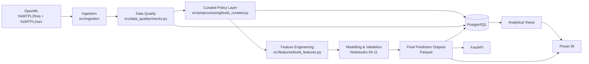

# Architektur – Kfz Insurance Risk & Pure Premium Intelligence Platform

## 1. Zweck

Dieses Dokument beschreibt die technische und analytische Architektur des Projekts **Kfz Insurance Risk & Pure Premium Intelligence Platform**.

Die Plattform ist als modularer End-to-End-Analytics-Prototyp aufgebaut und verbindet:

- reproduzierbare Datenbeschaffung,
- Data Quality,
- Curated Data Layer,
- Feature Engineering,
- statistische Modellierung,
- Modellvalidierung,
- Prediction-Artefakte,
- PostgreSQL,
- FastAPI,
- und Power BI.

Die Komponenten sind bewusst voneinander getrennt, damit Datenverarbeitung, Modellierung, Persistenz und Reporting nachvollziehbar bleiben.

---

## 2. High-Level-Architektur

Die Architektur folgt damit einem klaren Datenfluss von den unveränderten Quelldaten bis zu analytischen Decision-Support-Oberflächen.

---

## 3. Datenquellen

Die Plattform verwendet zwei öffentlich verfügbare OpenML-Datensätze:

- `freMTPL2freq`
- `freMTPL2sev`

### freMTPL2freq

Policy-Level-Daten mit:

- Exposure,
- Schadenanzahl,
- Fahrermerkmalen,
- Fahrzeugmerkmalen,
- regionalen Merkmalen.

### freMTPL2sev

Claim-Level-Daten mit:

- Policy-ID,
- beobachtetem Schadenbetrag.

Die beiden Datensätze besitzen unterschiedliche Granularitäten und werden deshalb nicht direkt als einfacher One-to-One-Join verarbeitet.

---

## 4. Ingestion Layer

Zentrale Implementierungen:

- `src/ingestion/fetch_openml.py`
- `src/ingestion/inspect_raw_data.py`
- `src/ingestion/test_openml_access.py`

Aufgaben der Ingestion-Schicht:

- reproduzierbarer Zugriff auf OpenML,
- technische Prüfung der Datenquelle,
- unveränderte Speicherung der Rohdaten,
- Erfassung zentraler Pipeline-Metadaten.

Die Raw-Daten bleiben unverändert erhalten. Fachliche Transformationen erfolgen erst in nachgelagerten Schichten.

---

## 5. Data-Quality-Layer

Zentrale Implementierung:

`src/data_quality/checks.py`

Die Data-Quality-Schicht prüft unter anderem:

- Exposure-Grenzen,
- Schadenanzahl-Grenzen,
- positive Schadenhöhen,
- Duplikate,
- fehlende Werte,
- Orphan-Severity-Records,
- Join-Kardinalität,
- Konsistenz zwischen `ClaimNb` und vorhandenen Severity-Records.

Die Ergebnisse werden nicht nur protokolliert, sondern zusätzlich strukturiert in PostgreSQL gespeichert.

Zentrale Tabelle:

`dq_check_results`

Damit steht Data Quality als eigenständige analytische und beobachtbare Schicht zur Verfügung.

### DQ-Prinzip

Ein DQ-Status `FAIL` bedeutet nicht automatisch, dass der finale Curated-Datensatz technisch unbrauchbar ist.

Die Statuswerte dokumentieren Befunde der Quelldatenprüfung. Anschließend wird für jeden relevanten Befund eine fachlich begründete Behandlung in der Curated- oder Modeling-Schicht definiert.

---

## 6. Curated Policy Layer

Zentrale Implementierung:

`src/preprocessing/build_curated.py`

Finaler Datensatz:

`data/processed/policy_curated.pq`

Die Curated-Schicht besitzt eine eindeutige Grain:

> **Eine Zeile pro `IDpol`**

Der finale Policy-Level-Datensatz umfasst:

- 678.013 Policen,
- 25 Spalten,
- keine doppelten `IDpol`.

Vor der Verbindung mit den Frequency-Daten werden die Severity-Records auf Policenebene aggregiert.

Dabei entstehen insbesondere:

- `total_claim_amount`
- `claim_record_count`

Zusätzlich enthält die Curated-Schicht Data-Quality- und Analysefelder wie:

- `exposure_capped`
- `high_claim_count`
- `claim_count_mismatch`
- `missing_severity`

sowie beobachtete Kennzahlen und Gruppenvariablen.

---

## 7. Feature Engineering

Zentrale Implementierung:

`src/features/build_features.py`

Die Feature-Schicht erzeugt zusätzliche analytische und modellierungsrelevante Merkmale.

Beispiele:

- `driver_age_group`
- `vehicle_age_group`
- `bonus_malus_segment`
- `log_density`

Die ursprünglichen Variablen bleiben dabei erhalten, sodass sowohl Rohmerkmale als auch abgeleitete Features nachvollziehbar verfügbar sind.

---

## 8. Canonical Train-/Test-Split

Der projektweit festgelegte Split wird gespeichert unter:

`data/processed/policy_train_test_split.pq`

| Split   | Policen |
| ------- | ------: |
| Train   | 542.410 |
| Holdout | 135.603 |

Der Split wird nach seiner Festlegung nicht neu erzeugt.

Damit verwenden Frequency-, Severity-, Tweedie- und Subgruppenanalysen dieselbe grundlegende Policy-Aufteilung.

Die jeweilige zulässige Evaluationspopulation unterscheidet sich jedoch abhängig von der Zielgröße.

---

## 9. Modelling & Validation Layer

Die finale Modellentwicklung und Evaluation wird primär in den nummerierten Notebooks dokumentiert.

| Notebook                              | Funktion                                  |
| ------------------------------------- | ----------------------------------------- |
| `04_frequency_model.ipynb`          | Frequency-Modellierung                    |
| `05_severity_model.ipynb`           | Severity-Modellierung                     |
| `06_model_comparison.ipynb`         | Modellvergleich und Two-Stage             |
| `07_tweedie_model.ipynb`            | Direktes Tweedie Pure Premium             |
| `08_model_explainability.ipynb`     | Modellinterpretation                      |
| `09_risk_segmentation.ipynb`        | Risikosegmentierung                       |
| `10_business_recommendations.ipynb` | Decision-Support-Logik                    |
| `11_subgroup_performance.ipynb`     | Subgruppen-Diagnostik und Responsible Use |

Die finalen Modellrollen sind bewusst komplementär.

### Frequency

Schätzung der annualisierten erwarteten Schadenfrequenz.

### Severity

Schätzung der erwarteten Schadenhöhe auf der zulässigen positiven Severity-Population.

### Two-Stage

Kombination aus:

`Predicted Frequency × Predicted Severity`

für monetäre Dekomposition und fachliche Interpretation.

### Tweedie

Direkte Modellierung des annualisierten Pure Premium.

Das Tweedie-Modell bildet den zentralen Score für Ranking und Risikosegmentierung.

---

## 10. Unterschiedliche Evaluationspopulationen

Die Architektur unterscheidet explizit zwischen verschiedenen Beobachtungsuniversen.

| Modell / Analyse          | Holdout-Population |
| ------------------------- | -----------------: |
| Frequency                 |    135.603 Policen |
| Severity                  |      4.999 Policen |
| Tweedie / Loss Evaluation |    133.790 Policen |

Der Grund liegt in der unvollständigen beobachtbaren Severity-Abdeckung.

Eine Police mit gemeldetem Schaden, aber unbekannter Schadenhöhe wird nicht so behandelt, als hätte sie einen Schadenbetrag von `0`.

Dadurch bleiben die Zielgrößen fachlich korrekt definiert.

---

## 11. Prediction Layer

Finale modellbasierte Outputs werden auf Policenebene als Parquet-Artefakte gespeichert.

Zentrale Dateien:

- `data/output/model_predictions.pq`
- `data/output/tweedie_predictions.pq`
- `data/output/risk_segments.pq`
- `data/output/policy_action_priorities.pq`

### model_predictions

Enthält insbesondere:

- Frequency-Modellversion,
- Severity-Modellversion,
- `predicted_frequency`,
- `predicted_severity`,
- `predicted_pure_premium`,
- `exposure_used`,
- `expected_claim_count`,
- `expected_claim_amount`,
- Prediction Run ID,
- Scoring-Zeitpunkt.

### Tweedie Predictions

Enthalten insbesondere:

- Tweedie-Modellversion,
- direkt prognostiziertes Pure Premium,
- Exposure,
- Tweedie Expected Loss.

### Risk- und Decision-Support-Layer

Darauf aufbauend werden:

- Risk Deciles,
- LOW / STANDARD / ELEVATED / HIGH,
- operative Prioritäten,
- Decision-Support-Hinweise

abgeleitet.

---

## 12. PostgreSQL-Architektur

PostgreSQL dient als persistente analytische Datenschicht.

Die Datenbank trennt:

1. Staging,
2. analytische Facts,
3. Pipeline- und DQ-Metadaten,
4. Modellvorhersagen,
5. analytische Views.

### 12.1 Staging Layer

#### `stg_policy`

Enthält die technisch geladenen Policy-Daten.

#### `stg_claim`

Enthält die technisch geladenen Claim-Daten.

Diese Tabellen bilden die datenbankseitige Eingangsschicht.

---

## 13. Analytical Fact Layer

### `fact_policy_exposure`

Zentrale Policy-Level-Fact-Tabelle.

Primärschlüssel:

`idpol`

Sie enthält:

- Policy-Merkmale,
- Exposure,
- beobachtete Schadenanzahl,
- aggregierte Schadenhöhe,
- DQ-Flags,
- beobachtete Kennzahlen,
- Feature-Gruppen.

Damit bildet sie die zentrale analytische Policy-Grain der Datenbank.

### `fact_claim`

Claim-Level-Fact-Tabelle.

Sie ermöglicht Schadenanalysen auf Ereignisebene und wird über `idpol` mit der Policy-Schicht verbunden.

---

## 14. Pipeline- und Data-Quality-Metadaten

### `pipeline_runs`

Dokumentiert ausgeführte Datenpipeline-Läufe.

Gespeichert werden unter anderem:

- Laufzeitpunkt,
- Pipeline-Status,
- Datenquelle,
- Frequency-Zeilenanzahl,
- Severity-Zeilenanzahl,
- technische Validierungsergebnisse.

### `dq_check_results`

Speichert die Ergebnisse einzelner Data-Quality-Prüfungen.

Damit können DQ-Befunde historisch und strukturiert ausgewertet werden.

---

## 15. Prediction Tables

### `policy_frequency_predictions`

Speichert Frequency-spezifische Predictions auf Policenebene.

Enthalten sind unter anderem:

- beobachtete Schadenanzahl,
- Exposure,
- prognostizierte Frequency,
- prognostizierte Schadenanzahl,
- Modellname,
- Scoring-Zeitpunkt.

### `model_predictions`

Speichert finale Frequency-, Severity- und Two-Stage-Predictions.

Der Primärschlüssel besteht aus:

`prediction_run_id + idpol`

Damit können mehrere Prediction-Läufe nachvollziehbar gespeichert werden.

Zusätzlich bestehen Datenbank-Constraints für:

- positive Frequency-Predictions,
- positive Severity-Predictions,
- positive Pure-Premium-Predictions,
- positive Exposure,
- nichtnegative Expected Claims,
- nichtnegative Expected Loss.

Indizes auf:

- `idpol`
- `scored_at`

unterstützen analytische Abfragen.

---

## 16. Analytical Views

Die SQL-Views bilden eine fachlich definierte Schnittstelle zwischen Datenbank und Reporting.

### `vw_policy_risk_base`

Zentrale Policy-Risikobasis.

Sie kombiniert:

- Policy-Merkmale,
- Exposure,
- beobachtete Kennzahlen,
- DQ-Flags,
- Feature-Gruppen,
- Claim-Status.

### `vw_claim_analysis`

Verbindet Claim-Level-Daten mit den relevanten Policy-Merkmalen.

Damit können Schadenhöhe und Schadenstruktur im Kontext von Fahrer-, Fahrzeug- und Regionalmerkmalen analysiert werden.

### `vw_dq_summary`

Stellt je Kombination aus Data-Quality-Check und Dataset den jeweils aktuellsten DQ-Lauf bereit.

Damit erhält Power BI eine kompakte aktuelle DQ-Sicht, ohne historische Runs manuell filtern zu müssen.

### `vw_frequency_prediction_analysis`

Verbindet Frequency-Predictions mit:

- Policy-Merkmalen,
- Exposure,
- beobachteter Frequency,
- erwarteter Schadenanzahl,
- Residuen.

### `vw_model_prediction_analysis`

Verwendet automatisch den zuletzt gespeicherten Prediction-Lauf aus `model_predictions`.

Die View verbindet diesen Lauf mit:

- Policy-Merkmalen,
- beobachteten Kennzahlen,
- DQ-Flags,
- Frequency-Predictions,
- Severity-Predictions,
- Two-Stage Pure Premium,
- Expected Claims,
- Expected Loss,
- Residuen.

Damit steht eine eindeutige aktuelle Policy-Level-Modellsicht für analytische Anwendungen zur Verfügung.

---

## 17. Power-BI-Architektur

Das finale Dashboard befindet sich unter:

`powerbi/kfz_insurance_risk_dashboard.pbix`

Die finale Power-BI-Lösung verwendet mehrere fachlich getrennte Quellen.

### Zentrale Datenquellen

**Policy / Model Analysis**

PostgreSQL:

`vw_model_prediction_analysis`

**Risk Segmentation / Decision Support**

Policy-Level-Parquet:

`data/output/policy_action_priorities.pq`

**Data Quality**

PostgreSQL:

`vw_dq_summary`

**Pipeline Monitoring**

PostgreSQL:

`pipeline_runs`

Damit verbindet Power BI:

- beobachtete Portfolioinformationen,
- Two-Stage-Modelloutputs,
- Tweedie-Risikoscores,
- Risikosegmentierung,
- Data Quality,
- Pipeline-Metadaten.

Die fachlichen KPI werden überwiegend auf Policy-Level über DAX berechnet und nicht aus einer statischen Management-Summary übernommen.

---

## 18. Power-BI-Datenmodell

Die zentralen analytischen Tabellen im Dashboard sind:

- `Policy`
- `RiskActions`
- `DataQuality`
- `ModelValidation`
- `PipelineRuns`
- `_Measures`

Zwischen:

`Policy[idpol]`

und:

`RiskActions[idpol]`

besteht eine aktive One-to-One-Beziehung.

Beide Tabellen befinden sich auf Policy-Grain.

Dadurch können Policy-Merkmale, Two-Stage-Ergebnisse und Tweedie-basierte Risikosegmentierung gemeinsam ausgewertet werden.

---

## 19. FastAPI Layer

Die prototypische API befindet sich unter:

`api/`

Zentrale Dateien:

- `api/main.py`
- `api/predictor.py`
- `api/schemas.py`

Verfügbare Schnittstellen:

| Methode | Endpoint                  |
| ------- | ------------------------- |
| GET     | `/health`               |
| POST    | `/risk-score`           |
| POST    | `/pure-premium`         |
| GET     | `/data-quality-summary` |

Die API demonstriert, wie zentrale Risiko- und Pure-Premium-Ergebnisse technisch in eine nachgelagerte Anwendung integriert werden könnten.

Sie ist ausdrücklich **kein produktives Echtzeit-Underwriting-System**.

---

## 20. Exposure-basierte Architekturregel

Exposure ist eine zentrale fachliche Komponente der gesamten Plattform.

Annualisierte Modelloutputs dürfen nicht direkt als absolute Portfolio-Beträge aufsummiert werden.

Es gilt:

`Expected Claims = Predicted Frequency × Exposure`

und:

`Expected Loss = Predicted Pure Premium × Exposure`

Diese Regel wird sowohl in:

- Modellierung,
- Prediction Outputs,
- PostgreSQL,
- Power BI,
- und Portfolio-Reporting

konsistent berücksichtigt.

---

## 21. Observability und Nachvollziehbarkeit

Die Architektur enthält mehrere Mechanismen zur Nachvollziehbarkeit.

### Pipeline-Level

`pipeline_runs`

dokumentiert technische Datenpipeline-Läufe.

### Data-Quality-Level

`dq_check_results`

dokumentiert DQ-Prüfungen und ihre Ergebnisse.

### Prediction-Level

`prediction_run_id`

und Modellversionsfelder ermöglichen die Zuordnung gespeicherter Predictions zu einem konkreten Modelllauf.

### Reporting-Level

Power BI verwendet definierte Views und Policy-Level-Outputs statt unkontrollierter Raw-Joins.

Damit sind Herkunft und Bedeutung der wichtigsten Reporting-Kennzahlen nachvollziehbar.

---

## 22. Responsible Architecture

Die Architektur trennt bewusst:

- modellierte Risikoschätzung,
- fachliche Interpretation,
- und tatsächliche Geschäftsentscheidung.

Ein Modellscore löst keine automatische Annahme- oder Ablehnungsentscheidung aus.

Insbesondere gilt:

- HIGH Risk bedeutet keine automatische Ablehnung.
- Pure Premium ist kein Kundenpreis.
- Risikosegmente dienen der Priorisierung und Analyse.
- fachliche Underwriting-Entscheidungen bleiben außerhalb der automatisierten Modelllogik.

Die technische Architektur unterstützt damit einen **Human-in-the-Loop Decision-Support-Ansatz**.

---

## 23. Bekannte Architekturgrenzen

Die Plattform ist ein prototypisches Abschlussprojekt und keine produktive Versicherungsplattform.

Nicht umgesetzt sind unter anderem:

- produktives Echtzeit-Scoring,
- produktive Authentifizierung und Autorisierung,
- Enterprise-Orchestrierung,
- automatisiertes Model Registry Management,
- vollständige Drift-Infrastruktur,
- automatisches Re-Training,
- produktive CI/CD-Deployment-Pipeline,
- vollständige regulatorische Produktionskontrollen.

Diese Elemente wären bei einer produktiven Weiterentwicklung zusätzliche Architekturbausteine.

---

## 24. Zusammenfassung

Die Architektur verbindet einen reproduzierbaren Analytics-Workflow mit einer klaren Trennung der Verantwortlichkeiten:

`OpenML → Ingestion → Data Quality → Curated Layer → Features → Modelling → Predictions → PostgreSQL / FastAPI / Power BI`

Die wichtigsten Architekturprinzipien sind:

- eindeutige Policy-Grain,
- explizite Exposure-Behandlung,
- Trennung von Frequency und Severity,
- transparente Missing-Severity-Logik,
- reproduzierbarer canonical Split,
- versionierte Prediction-Läufe,
- strukturierte Data-Quality-Ergebnisse,
- definierte analytische SQL-Views,
- getrennte Modellrollen,
- und Responsible Decision Support.

Damit bildet die Plattform nicht nur eine Sammlung einzelner Analysen, sondern einen nachvollziehbaren End-to-End-Prototyp für datenbasierte Kfz-Risikoanalyse.
